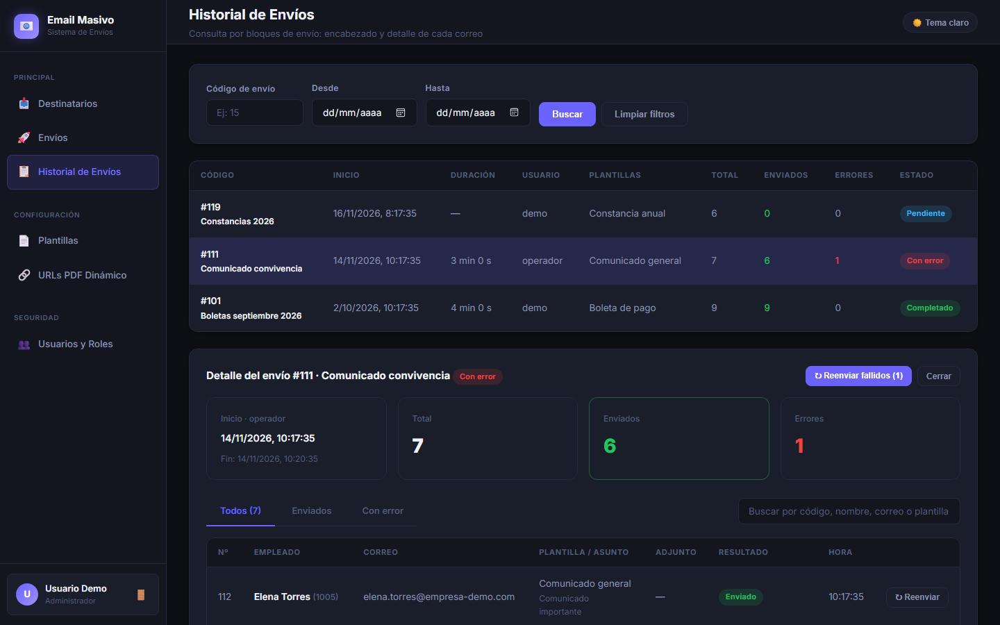

# Envío masivo de correos · React



**[Ver demo en vivo](https://eddcas01.github.io/envio-masivo-correos/)**: entra con `demo` / `demo`.

> Versión de muestra del frontend de un sistema de envío masivo de correos que desarrollé en un entorno
> corporativo. En la demo, el backend se **simula en el navegador** y todos los nombres, correos y datos son
> **ficticios**.

Herramienta interna con la que Recursos Humanos envía correos personalizados a cientos de colaboradores, como
boletas de pago, constancias o comunicados, cada uno con su **PDF adjunto**.

## Funcionalidades

- **Asistente de envío en 3 pasos**: cuerpo del correo (plantilla), destinatarios (por código, o todos los
  activos de una empresa) y adjuntos.
- **Tres modos de adjunto**: sin adjunto, **PDF dinámico** generado por empleado desde una URL de reportes, o
  **archivos subidos** (PDF o ZIP). En el último modo cada archivo se asocia a su colaborador por código de
  empleado, NIT o CUI que aparezca en el nombre.
- **Envío con progreso en vivo**: porcentaje, enviados, errores y un registro de actividad que se actualiza
  por *polling*.
- **Historial por bloques**: detalle por correo con filtros y búsqueda, **reenvío de los fallidos** como un
  envío nuevo y opción de agregar colaboradores a un envío pendiente.
- **Plantillas HTML** con editor enriquecido (Quill), variables (`{{Nombre}}`, `{{Periodo}}`…) y vista
  previa en un `iframe` aislado.
- **Seguridad**: login con **Microsoft Entra ID (MSAL)** que reutiliza la sesión de Windows, o con usuario
  local. Usa **roles y permisos por pantalla** con una matriz editable, rutas protegidas y JWT con
  interceptores de axios.
- Tema claro y oscuro.

## Arquitectura de la demo

La app usa una sola instancia de axios (`src/api/api.js`). En modo demo se le conecta un **adaptador propio**
(`src/api/demoAdapter.js`) que implementa en memoria las mismas rutas REST del backend: un pequeño router con
parámetros, estado de envío, latencia simulada y errores HTTP reales. Gracias a eso, **ningún componente sabe
que está en demo**.

```bash
npm install
npm run dev                                                # modo demo (por defecto)
VITE_DEMO=false VITE_API_URL=https://mi-api/api npm run dev  # contra el backend real
```

## Stack

React 18 · Vite · React Router · axios · MSAL (`@azure/msal-browser`) · React Quill · CSS propio con variables
(tema claro/oscuro)
